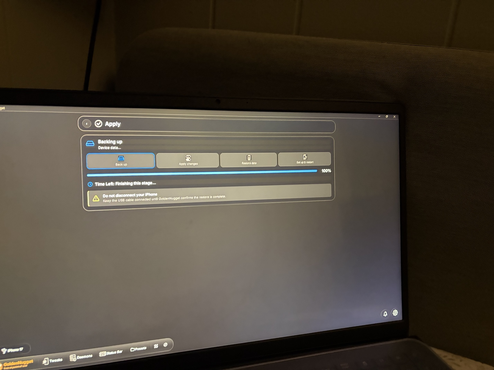
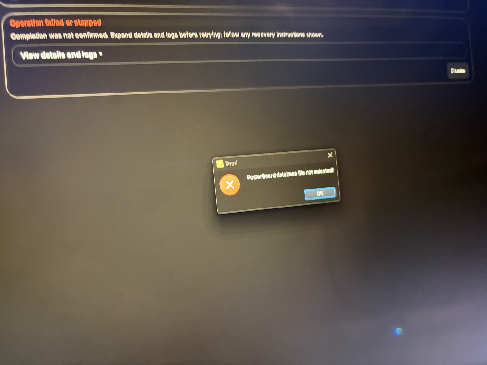
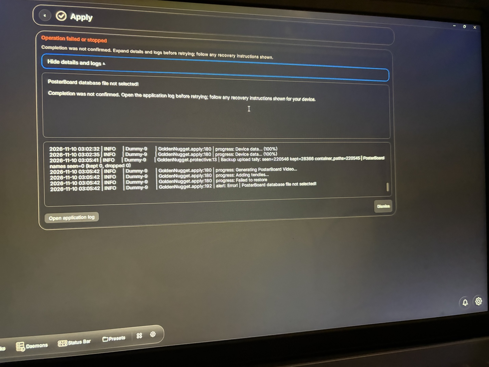

# GoldenNugget desktop: Mond `.batter` Apply fails after multi-hour backup

Date: 2026-11-10. Status: **reproduced on user device with screenshots; source regression test passes, actual device retest pending.** This is a handoff for independent review by Claude or another developer. Do not mark resolved based on CI alone.

## Environment and intent
- Windows GoldenNugget desktop fork `soum91/GoldenNugget`.
- iOS 27.x device, reported 27.0.1 in related test; verify device/build from fresh log.
- Imported a community Mond iOS 27 windowing experiment `.batter` template (format 3, community/non-PosterBoard domain).
- **No wallpaper / PosterBoard modification was requested.** Goal: apply Mond tweak only.
- A prior attempt failed before backup because Windows backup cache drive had only **31.8 GiB** free; user subsequently addressed space/location and retried.
- The next attempt took roughly **3+ hours**, including full device/media backup, and failed *after* the backup reached 100%. Avoid another blind multi-hour retry.

## Actual user-visible result
1. Apply starts backing up "Device data..." with a 50+ minute ETA, taking hours overall.
2. UI reaches 100% in the **Backing up** stage; says "Finishing this stage...".
3. UI moves to "Generating PosterBoard Video...", then "Adding tendies...".
4. UI reports "Failed to restore" / "Operation failed or stopped".
5. Modal and expanded detail: **`PosterBoard database file not selected!`**. Completion was not confirmed. Do not assume the tweak was installed.

### Relevant screenshot transcription (names and identifiers removed)
```text
2026-11-10 03:02:32 | INFO | GoldenNugget.apply:180 | progress: Device data... (100%)
2026-11-10 03:02:35 | INFO | GoldenNugget.apply:180 | progress: Device data... (100%)
2026-11-10 03:05:41 | INFO | Dummy-9 | GoldenNugget.protective:13 |
  Backup upload tally: seen=220546 kept=28366 container_paths=220545 |
  PosterBoard names seen=0 (kept 0, dropped 0)
2026-11-10 03:05:42 | INFO | GoldenNugget.apply:180 | progress: Generating PosterBoard Video...
2026-11-10 03:05:42 | INFO | GoldenNugget.apply:180 | progress: Adding tendies...
2026-11-10 03:05:42 | INFO | GoldenNugget.apply:180 | progress: Failed to restore
2026-11-10 03:05:42 | INFO | GoldenNugget.apply:192 | alert: Error! |
  PosterBoard database file not selected!
```
`PosterBoard names seen=0` is expected for a non-wallpaper template and should **not** trigger PosterBoard compilation. Full application log was not supplied, only these screenshots.

## Root-cause hypothesis from source inspection
- `src/devicemanagement/posterboard_intent.py` already distinguished community templates from PosterBoard database intents in one earlier preflight path.
- However `src/tweaks/posterboard/posterboard_tweak.py::apply_tweak` previously used `len(templates) == 0` as an exit guard, thus **any** template entered PosterBoard staging.
- `src/controllers/tweak_compiler.py::_compile_package` also registered `PosterboardTweak` alongside `TemplatesTweak`, causing a non-wallpaper template to invoke both. The PosterBoard path then requested a DB that the backup intentionally did not include.

## Fix attempted and delivered to main (not device-verified)
- `ad4c55accb36375ccbba13fce72680f8e2c821ee`: `has_posterboard_changes()` distinguishes actual DB/video/tendie and reset requests.
- `bf77283ebc9c646f3abc501c4ba87a72d6eb86e2`: guard PosterboardTweak.apply_tweak with `needs_posterboard_database()`.
- `5702de38761624aa3237f14a524057162603cf70`: skip PosterboardTweak in compiler for unrelated templates.
- `bc2cca242bd92a69ba1e50eda4c54f560917248f`: unit tests for intent.
- `fbfa6c86ab43b091859c77a02645e125326f3fad`: integration test of compile path.
- `58164bbea2017497a1b95d4e3b2ecaca57270b98`: Windows workflow runs regression tests before packaging.
- `f31ad8d1cc92d12b32257b4877745ce5104f835a`: changelog.
- Windows workflow run #2: https://github.com/soum91/GoldenNugget/actions/runs/42874200965 , **CI passed**. `GoldenNugget-Windows` artifact, head SHA `f31ad8d`. The old run #1 executable is NOT corrected.

## Required follow-up for Claude
1. Review whether this guard is complete across every entry point and template format (including empty domain, app-domain, and true `com.apple.PosterBoard` domains).
2. Verify `TemplatesTweak` still applies Mond. Passing a *skip-PosterBoard* test does not prove the actual tweaks are applied.
3. Add an end-to-end preflight **before a multi-hour protective backup** to surface predictable template/compiler errors, without weakening any required data-protection checks. Investigate safe reuse of completed backups.
4. Ensure failure reporting correctly distinguishes "compilation failed before restore" from "restore failed". Preserve logs and definitive device state.
5. Device-test the new artifact on the same non-wallpaper `.batter` scenario. Check installed behavior, not only a green CI badge.
6. Do not change device settings or skip iOS protective-backup safety merely to make the error disappear.

## Evidence
User-supplied photos: `IMG_8485.jpeg` (backup at 100%), `IMG_8486.jpeg` (error modal), `IMG_8487.jpeg` (expanded log). All three original evidence images are committed at `docs/diagnostics/evidence/` and embedded below. No device UDID/serial/account credentials are included.

### Screenshot evidence

**Backup reached 100%:**



**Failure modal after backup:**



**Expanded failure log:**



No device UDID/serial/account credentials are included.

## Companion mobile fork
Claude should also cross-check the mobile implementation against the [mobile cross-repository handoff](https://github.com/soum91/GoldenNugget-mobile/blob/main/docs/diagnostics/2026-11-10-mond-posterboard-crosscheck.md). The crash above occurred on Windows; no mobile reproduction is claimed.

## Claude follow-up review (2026-11-10, later)

Status after this pass: **source fix extended and tested offline; still not device-verified.**

1. **Guard completeness.** All four routing points (device_manager's backup decision, `tweak_compiler._compile_package`, `PosterboardTweak.apply_tweak`, `TemplatesTweak.apply_tweak`) now share `posterboard_intent.is_posterboard_template()`. It is case/whitespace tolerant, so a hand-edited domain can't pass one check and fail another. Empty domain, other app domains and `Sparserestore-` domains are not PosterBoard; both PosterBoard spellings are. The PosterKit conflict check in the compiler now uses `has_posterboard_changes`, so a community batter no longer blocks PosterKit.
2. **TemplatesTweak really applies Mond-style tweaks.** `tools/test_mond_apply_preflight.py` runs a real format-3 windowing `.batter` through import and the real `compile_tweaks`. `SBChamoisWindowingEnabled` reaches the community writer (True when on, `writes_off` False when off), no PosterBoard file is staged, and the PosterBoard DB accessor is never called. The original Mond `.batter` was not available to this review, so the fixture copies its shape (format 3, empty domain, Managed Preferences SpringBoard write), not its exact keys.
3. **Pre-backup preflight.** `src/controllers/apply_preflight.py` runs in `_apply_changes` before Phase 0 and raises `ApplyPreflightError` ("before any backup or restore started") for: template min/max iOS mismatch (previously a post-backup `ValueError` in TemplatesTweak), unresolvable community writes, unstageable file templates, DB-less PosterBoard work that would need a DB, and PosterKit + wallpaper conflicts. It never skips or shortens the protective backup. Backup reuse was not changed in this pass: the existing protective cache (`_prepare_protective_backup`) is the place to look, but reusing a completed backup safely needs its own design and a device test.
4. **Failure stage reporting.** Exceptions from `compile_tweaks` are tagged `nugget_apply_stage="compile"`, and preflight failures `"preflight"`. `show_apply_error` then shows "Failed while preparing tweaks (nothing restored)" / "Preflight check failed" instead of "Failed to restore", and the alert says nothing was restored. Restore only starts after compile (`start_restore` in `_apply_tweak_pass`), so that statement is accurate.
5. **Still open:** device retest of a rebuilt Windows artifact with the same non-wallpaper `.batter`, checking the installed behavior. Offline tests passing is not device success.

Test run (Linux, offscreen Qt, partial deps): `tools/run_tests.py` gave identical pass/fail sets before and after this change (pre-existing failures are missing-numpy/opencv environment issues plus `test_community_tweaks` preference-reset baseline), plus the new `test_mond_apply_preflight` passing.
